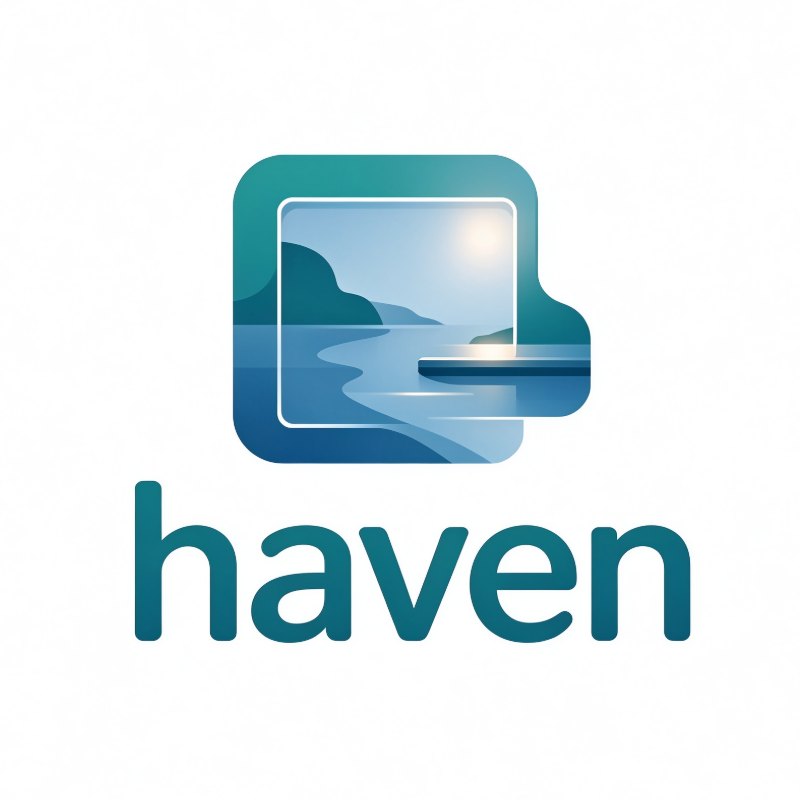

# Haven

<p align="center">
  
</p>

<p align="center">
  <strong>Windows / macOS 本地照片与视频管理工具</strong><br>
  不上传，不导入，把散落在硬盘各处的照片收进一个顺滑入口。
</p>

> 你还在 C 盘、D 盘、下载文件夹、相机导出目录之间来回翻找照片吗？  
> 你还在资源管理器里打开几百张照片，然后看着它转圈、卡死、未响应吗？  
> **Haven 就是为这些瞬间准备的。**

Haven 直接浏览电脑上的文件夹，不要求你把照片导入专用图库，也不会上传影像。它把不同磁盘、不同目录中的照片集中到一个快速、清爽的界面里，让你搜索、筛选、评分、打标签、看原图。界面支持深浅主题和毛玻璃效果，面板使用 CSS `backdrop-filter` 实现磨砂玻璃，不依赖 WebGL2。

---

## 为什么是 Haven？

- **散落各处的照片，统一入口浏览**  
  添加多个照片目录，展开目录树，或搜索尚未展开的子文件夹。照片不必搬家，原图留在原处，Haven 帮你把它们找回来。

- **数千张照片，依旧顺滑**  
  照片网格只渲染当前屏幕附近的卡片，不会一次性把几千张缩略图全部画出来。扫描结果、缩略图和 RAW 等格式的预览会被缓存，大目录二次打开更快。

- **不导入、不上传、不打扰原文件**  
  原始影像保留在原目录。Haven 只在你需要时读取、预览和整理，适合希望保留文件夹结构的用户。

- **像整理音乐一样整理照片**  
  评分、标签、颜色标签、收藏、旗帜、Rejected 状态、智能相册，全都围绕你已有的目录工作。

---

## 性能：为大量照片而生

Haven 不是把几千张原图一次性塞进内存，而是：

- **视口虚拟化**：照片网格只渲染当前屏幕附近的卡片，滚动时按需加载。
- **多级缓存**：扫描索引、缩略图、RAW 预览都会被缓存，减少重复扫描和解码。
- **按需读取原图**：浏览列表时不会把所有大图全部载入，查看照片时才读取原图。
- **跨目录智能查找**：智能相册可组合筛选条件，在已添加的目录中跨文件夹查找照片。

所以，哪怕一个文件夹里有数千张照片，浏览、筛选、切换目录，也不用等到天荒地老。

---

## 主要功能

- **按文件夹浏览**  
  添加多个照片目录，展开目录树，或在侧边栏搜索尚未展开的子文件夹。照片列表上方会显示当前目录的直属子文件夹；侧边栏宽度可拖动调整。

- **查找与整理**  
  按文件名搜索；按格式、评分、标签、颜色标签、收藏、旗帜及 Rejected 状态筛选；按名称、日期、大小等排序。智能相册可以组合这些条件，跨已添加的目录查找照片。

- **批量处理**  
  进入选择模式后，可批量设置评分、标签、颜色标签和状态，也可以把选中的照片拖到侧边栏中的其他文件夹。

- **全屏查看**  
  查看照片详情，缩放、平移和旋转预览；在底部工具栏直接修改评分、收藏、旗帜、Rejected、标签和颜色标签。视频可在支持的编码下内嵌播放。

- **本地缓存**  
  扫描结果、缩略图和 RAW 等格式的预览会被缓存；照片网格只渲染当前屏幕附近的卡片。

- **规范修图流程**  
  拍完可立即选片，一键打开ps等软件，选片修图一站式

  - **智能堆叠**  
  可自动识别堆栈照片，自动合并不占地
---

## 下载与安装

### Windows 10/11 x64

需要 Microsoft Edge WebView2 Runtime。新版 Windows 通常已安装；缺失时可从 [Microsoft 官方页面](https://developer.microsoft.com/microsoft-edge/webview2/) 安装。

1. 从 [Releases](https://github.com/christo112233/Haven/releases/latest) 下载 `Haven-win64.zip`。
2. 完整解压到有写入权限的位置，例如 `D:\Apps\Haven`。
3. 运行 `Haven.exe`。

> 请保留解压后的 `updater.exe`、`version.txt` 和 `_internal/`，不要单独移动主程序。  
> 发布包已包含所需的 Python 运行环境。

### macOS（Apple Silicon）

macOS 版目前只提供 **arm64（Apple Silicon）** 构建，最低 macOS 11。发布包没有 Apple 开发者签名与公证，因此首次打开需要手动放行：

1. 从 [Releases](https://github.com/christo112233/Haven/releases/latest) 下载 `Haven-mac-arm64.dmg`。
2. 双击打开 DMG，在弹出的安装窗口中把 `Haven.app` 拖到「Applications（应用程序）」快捷方式上，然后推出磁盘映像。
3. 首次打开时若提示"无法验证开发者"：在 **系统设置 → 隐私与安全性** 中点「仍要打开」；也可以右键 `Haven.app` → 打开。
4. 如果系统提示"已损坏"，在终端执行一次：

   ```bash
   xattr -dr com.apple.quarantine /Applications/Haven.app
   ```

> 同一 Release 里也提供 `Haven-mac-arm64.zip`，解压后拖入「应用程序」效果相同；应用内自动更新使用 zip 包。
> 更新时 Haven 会自动下载、校验并替换旧版本（成功后自动重启，并在下次启动时清理旧版本与安装包）。请把 `Haven.app` 放在可写位置（通常是「应用程序」）；从「下载」目录或只读的 DMG 里直接运行时会拒绝更新，并提示你先移动应用。由于没有 Apple 开发者签名/公证，更新后 macOS 可能重新询问照片目录的访问权限。
> Intel Mac 暂不支持（RAW 解码依赖目前只提供 arm64 wheel）。

macOS 菜单栏已接入原生能力：Haven 菜单（关于 / 设置 ⌘, / 检查更新 / 退出）、文件（添加文件夹 ⌘O / 重新扫描 ⌘R / 关闭窗口 ⌘W）、编辑（复制文件路径 ⌘⇧C）、显示（显示/隐藏侧边栏 ⌥⌘S、外观跟随系统/浅色/深色、全屏 ⌃⌘F）。

源码运行、测试和构建方法见[开发文档](docs/开发文档.md)。

---

## 快速上手

1. 点击侧边栏「文件夹」旁的添加按钮选择目录，也可以把文件夹拖入侧边栏。
2. 点击文件夹浏览其中的照片；勾选「包含子文件夹」可将下级目录中的影像一并列出。点击照片进入全屏预览。
3. 用顶部搜索和筛选控件缩小结果范围；通过照片右键菜单或全屏工具栏设置评分与标签。点击选择按钮可一次处理多张照片。
4. 点击开始选片，创建一个选片目录，把要修的照片放到一个统一的文件夹内
### 全屏快捷键

| 按键 | 操作 |
| --- | --- |
| `←` / `→` 或 `A` / `D` | 上一张 / 下一张 |
| `Space` | 适应窗口 |
| `F` | 展开或收起详情 |
| `Esc` | 关闭预览 |

滚轮可缩放照片，拖动可平移。查看器中的旋转仅改变预览，不修改原文件。删除操作会先要求确认，然后将文件移入系统回收站。

---

## 格式与数据

Haven 识别常见图片（JPG、PNG、WebP、BMP、GIF、TIFF）、HEIC/HEIF、常见相机 RAW（如 CR2、CR3、NEF、ARW、DNG）及 MP4、MOV、MKV 等视频。RAW 的具体机型取决于 LibRaw；视频能否在窗口内播放取决于 WebView2 对容器和编码的支持，不支持时可交给系统默认程序打开。支持部分同名照片与视频配对的 Live Photo、Motion Photo。

原始影像保留在原目录。缩略图、预览和扫描索引位于各照片目录下的 `.Haven/`，Windows 与 macOS 共用同一套缓存，换平台不用重新生成。

评分、标签、收藏、旗帜、颜色标签及智能相册位于 **图库数据库** 中：

- Windows：默认在程序目录的 `library/library.sqlite3`（沿用旧版的 `haven-metadata.sqlite3` 会自动迁移）；
- macOS：`~/Library/Application Support/Haven/library/library.sqlite3`；
- 可以在 **设置 → 图库数据位置** 把图库数据库放到 NAS 等共享目录。Windows 和 macOS 指向同一个目录后，两边的评分、标签和智能相册保持同步；照片根目录中的 `.Haven/library.json` 记录稳定的图库/根目录 ID；
- 图库目录下的 `backups/` 会保留最近的数据快照；网络盘不可用时照片仍可浏览，标注暂不可用。

文件夹和外观等设置位于：

- Windows：程序目录的 `haven-settings.json`；
- macOS：`~/Library/Application Support/Haven/haven-settings.json`。

只读照片目录仍可浏览，但无法持久保存该目录的缓存或根目录 ID。移除一个图库根目录不会删除其照片、缓存或标注。

---

## 联网与更新

浏览和整理照片可离线进行。联网仅用于检查或下载 GitHub Releases 更新，以及主动打开更新历史。

- Windows / macOS：都支持应用内自动更新，可在设置中关闭自动检查。更新包会做 HTTPS、SHA256、版本号和代码签名校验；替换失败会自动回滚。
- macOS 的旧版本和下载缓存会在新版本首次成功启动后自动删除，不会长期占用磁盘；更新后如系统重新询问文件夹权限，按提示允许即可。

建议将 Windows 版放在可写目录，以便保存设置和安装更新。

---

## 平台支持

- Windows 10/11 x64：完整支持。
- macOS 11+（Apple Silicon）：支持浏览、整理、选片、选片导出、共享图库；
- 两个平台使用同一份代码与同一个版本号，发布时同时构建。

## 许可

Haven 使用 [MIT License](LICENSE)。第三方库和图标等的许可见 [THIRD_PARTY_NOTICES.md](THIRD_PARTY_NOTICES.md)。